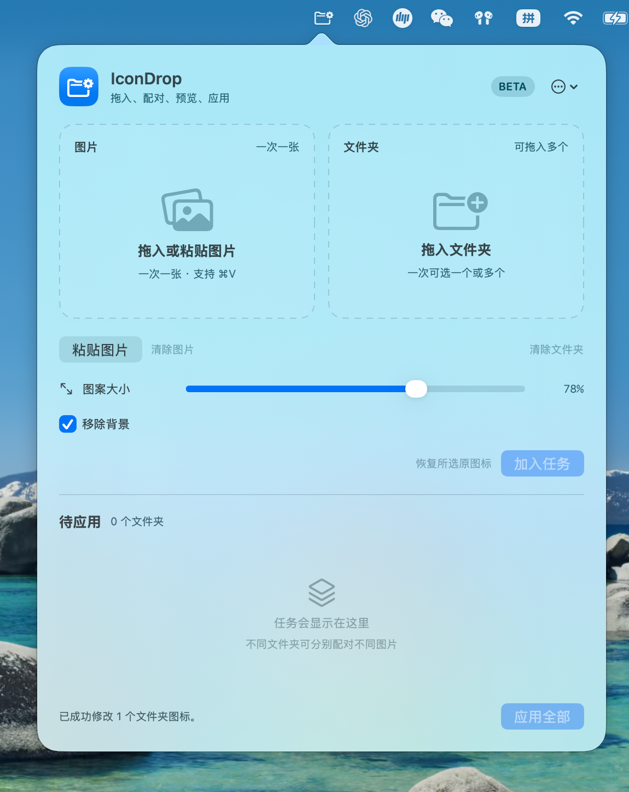

# IconDrop

[English](README.md) · [简体中文](README.zh-CN.md)

IconDrop is a small macOS menu bar utility for applying custom icons to folders in batches. This repository contains source code rather than a ready-to-open app. Follow the steps below to build and run it on your Mac.

## Preview



## What it does

- Assign one image to several folders, or give different folders different images by adding multiple tasks.
- Drag in one image file, or paste a copied image file or image content with the **Paste Image** button (`粘贴图片`) or **Command-V**.
- Normalize the visible content of each image on a transparent 512 × 512 canvas. Adjust its size with the slider and inspect the preview before applying.
- Optionally remove the background using macOS Vision. If no subject is detected, turn the option off or try another image.
- Back up each folder's icon state before IconDrop first changes it, then restore that original state later.

## Get started

You need a Mac running **macOS 14 or later**. There is no installer or prebuilt download yet, so you will build the app once on your Mac. **Git is optional.**

1. Open **Terminal**. If Apple's developer command line tools are not installed, run `xcode-select --install` and follow the installation window. These tools provide the Swift compiler; they are needed even if you download a ZIP instead of using Git.
2. Open the [IconDrop repository](https://github.com/jyx0919/IconDrop), click **Code → Download ZIP**, and unzip the download.
3. In Terminal, type `cd`, press **Space** once, drag the unzipped `IconDrop-main` folder from Finder into Terminal, then press **Return**. This takes Terminal into the project folder.
4. Copy these two commands into Terminal:

   ```sh
   bash scripts/build-app.sh
   open build/IconDrop.app
   ```

Look for the folder icon in the menu bar, at the top of the screen. The app does not open a normal window or appear in the Dock. If you do not see the icon, follow [these steps](#menu-bar-icon-not-visible). Later, you can double-click `build/IconDrop.app` in Finder to use it again; you only need to rebuild after changing or updating the code.

If you prefer Git, use `git clone https://github.com/jyx0919/IconDrop.git` and `cd IconDrop` instead of steps 2–3. The build script creates `build/IconDrop.app`, signs it locally, and automatically tries the installed macOS SDKs. If it says that no compatible SDK was found, install or update Apple's Command Line Tools or Xcode, then run the build command again. Contributors can run the core tests with `swift test` when their Xcode toolchain supports the package.

## How to use it

1. Click the IconDrop folder icon in the macOS menu bar. It has no Dock icon or separate main window.
2. Drag **one image file** into the left area, or copy an image file or image content and click `粘贴图片` / press **Command-V**. Drag **one or more folders** into the right area.
3. Adjust `图案大小` (image size) and, if needed, enable `移除背景` (remove background). Wait for the preview to finish.
4. Click `加入任务` (add task). For another image and another group of folders, repeat steps 2–4. To use the same image for every folder, put all those folders in one task.
5. Click `应用全部` (apply all). The panel reports successes and failures per batch; failed folders remain in the task list for retrying. A folder can appear only once in a batch.

Click outside the panel to close it, or click the menu bar icon again. Use the panel's `更多选项` (more options) menu to quit IconDrop.

### Examples

- **One image for several folders:** Drag one image into the left area and `Work`, `Photos`, and `Notes` into the right area. Adjust the preview, click `加入任务`, then `应用全部`. All three folders receive the same icon.
- **A different image for each folder:** Pair image A with `Work` and click `加入任务`. Then pair image B with `Photos` and add that task. Click `应用全部` once to apply both icons. Each task keeps its own image size and background removal setting.

### Restore an original icon

Drag the folders to restore into the **right** area and click `恢复所选原图标`. IconDrop restores the custom icon each folder had before its first IconDrop edit, or the system default folder icon if it had no custom icon. A backup is required; if it is missing or damaged, the app reports an error instead of silently replacing the icon.

Backups are stored in `~/Library/Application Support/IconDrop/OriginalIcons` and are removed after a successful restore. The core library also exposes `restoreDefaultIcon(for:)` to set the system default icon, but the current menu bar panel does not have a separate button for that operation.

Custom-icon backups created by earlier versions may be inaccurate. IconDrop skips affected folders and keeps those backups without changing the current icon. It cannot reconstruct an older, incorrect backup automatically. Older backups that recorded the system default icon can still be restored.

## Menu bar icon not visible

macOS can hide new menu bar icons when the right side is full, especially on Macs with a camera notch. The app may be running even though its icon is not visible.

1. Open **System Settings → Menu Bar → Allow in Menu Bar** (系统设置 → 菜单栏 → 允许在菜单栏显示) and make sure **IconDrop** is enabled.
2. Temporarily turn off one or two menu bar items you do not need. IconDrop should appear once there is enough room.
3. Hold **Command (⌘)** and drag the IconDrop icon toward the right side. Re-enable the other items if there is room.

Apple's [menu bar guide](https://support.apple.com/en-gb/guide/mac-help/mchlp1446/26/mac/26) explains how to rearrange status icons.

## License

IconDrop is released under the [MIT License](LICENSE).
